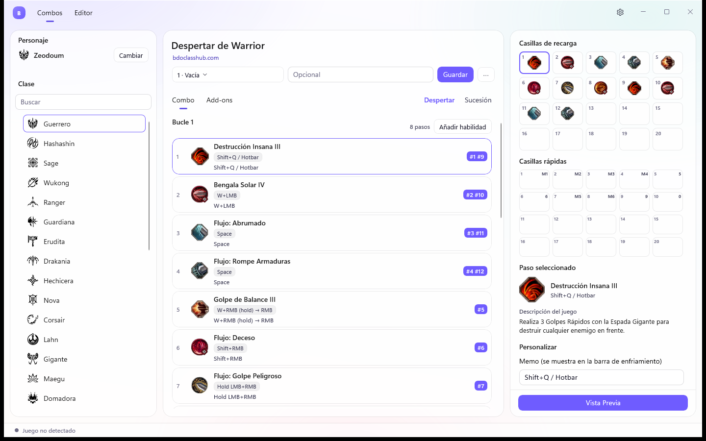
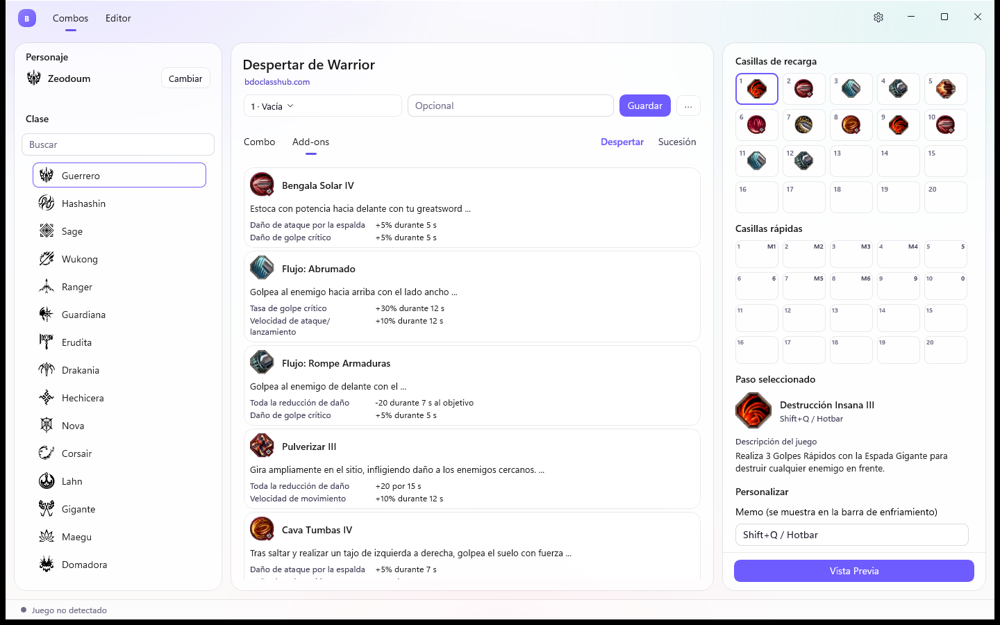
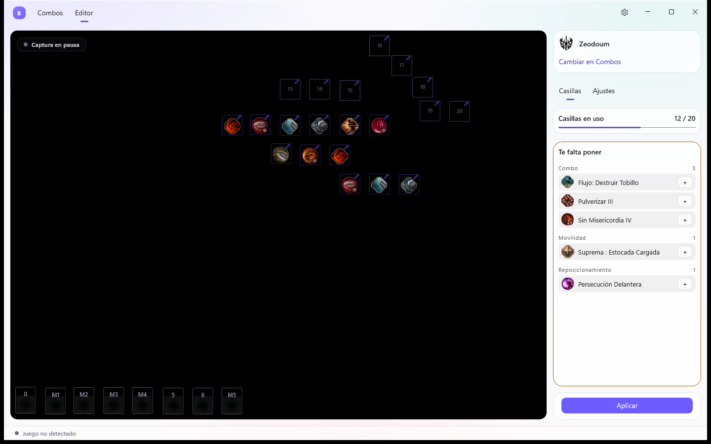

# BDOTempo

Your Black Desert skill bar, set up for you.

*The Combos page. The app is shown in Spanish; you can switch to English in Settings.*

## What is it?

BDOTempo is a free Windows app for Black Desert Online players. Pick a class guide from the community, and BDOTempo
sets up your skill bar, your quick slots and your memos on your character for you, in a few clicks instead of by hand.

- **Cooldown bar:** 20 slots that show when each skill is ready again.
- **Quick slots:** 20 more slots, each tied to a key for fast use.
- **Memos:** short notes shown on the cooldown bar.

## Download

Get the latest version from the [Releases page](https://github.com/TitoSaavedra/bdotempo/releases). You can choose:

- **Installer (recommended):** `BDOTempo-Setup-<version>.exe`. It adds a Start menu shortcut and does not need
  administrator rights by default.
- **Portable:** `BDOTempo-Portable-<version>.zip`. Unzip it anywhere and run `BDOTempo.exe`. Nothing is installed.

You need Windows 10 (version 1809 or later) or Windows 11, 64-bit. The installer also needs Microsoft's free
**.NET 10 Desktop Runtime**; if it does not find it, it can install it for you (Windows asks for permission first).
The portable zip already includes everything it needs.

## How to use it

1. **Choose your character and class.** If a character needs a login, log in with it once in the game and reopen
   BDOTempo.
2. **Choose a guide.** The **Combo** tab shows the buffs and the combo with the real game icons. The **Add-ons** tab
   shows the skills that come with the class.

   

   *The Add-ons tab: the class skills, with their effects.*

3. **Drag skills onto your slots.** Place them on your cooldown bar and quick slots, and change what you like. Save your
   version with **Save my combo**. You can keep up to 10 versions for each class and spec. Changed your mind? Open the
   **...** menu and choose **Use guide** to go back to the original.
4. **Check it in the Editor.** The Editor draws your slots over the live game window and lists what is still missing.
   If the game is closed, the background is black.

   

   *The Editor: your slots over the game, and what is still to place.*

5. **Press Apply.** Close the game first, because the app does not write while it runs. Choose what to write (cooldown
   bar, memos or quick slots), review the changes and confirm. BDOTempo backs up your character before it writes.
   Then go to the character selection screen in the game so it can read the changes.

After the first setup, a short guided tour shows you the main pages. It never writes to your character, and you can
repeat it from Settings (the gear icon at the top right).

## Is it safe?

- **A checked backup before every change.** BDOTempo copies your character file and checks the copy first. If the copy
  cannot be checked, nothing is written.
- **Automatic restore.** If the check after writing fails, your backup is put back.
- **It never touches the game.** BDOTempo does not open, close or change the game, and it sends it no keys or clicks.
  The Editor only shows what is on your screen.
- **Nothing changes until you press Apply.** Saving combos and checking them in the Editor does not touch your
  character.

## Updates

BDOTempo tells you when a new version is out, and you choose whether to update now. You can turn off the check at
startup in Settings. With the portable zip, an update opens the download page in your browser instead.

## Questions or problems?

Tell us what happened on the [Issues page](https://github.com/TitoSaavedra/bdotempo/issues). Include what you were
doing and what you saw.

## Credits

BDOTempo is an unofficial fan project. It is not affiliated with, endorsed by or sponsored by Pearl Abyss.
Black Desert, Black Desert Online and all their art, including the skill and class icons shown in the app, belong to
Pearl Abyss.
